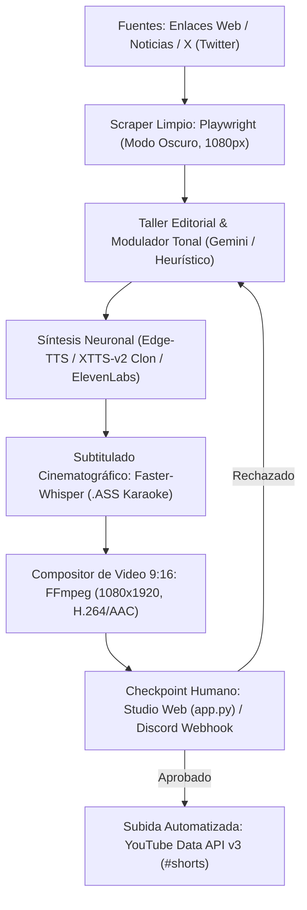

# Proyecto 2: Pipeline de Noticias Automatizadas (AdSense & YouTube Shorts)
**Shameless Company — Célula B (Pipelines IA)**  
*Registro Integral de Contexto, Arquitectura Técnica y Estado de Avance hacia el Objetivo*

---

## 1. Contexto Estratégico y Propósito

El **Proyecto 2** forma parte del ecosistema operativo de **Shameless Company**, diseñado para generar ingresos pasivos y recurrentes mediante canales automatizados en YouTube Shorts y TikTok, cubriendo el 100% de la infraestructura inicial con beneficios de costo cero (GitHub Student Pack).

```
                      [Shameless Company HQ]
                                │
        ┌───────────────────────┼───────────────────────┐
        ▼                       ▼                       ▼
  [Célula A: Media FX]    [Célula B: Pipelines IA] [Célula C: Audio & Content ID]
                           - Proyecto 2: Noticias
                           - Proyecto 3: Tutoriales SaaS
```

### El Problema Crítico: Desmonetización en YouTube (YPP / AdSense)
La mayoría de canales automatizados son desmonetizados en las primeras semanas debido a dos causales estrictas del YouTube Partner Program (YPP):
1. **Contenido Reutilizado (*Reused Content*):** Tomar material de terceros (tweets, noticias de prensa, reddit) sin añadir un valor crítico, editorial o educativo sustancial.
2. **Contenido Repetitivo (*Repetitive/Templated Content*):** Videos producidos masivamente donde solo varía un texto plano sobre un fondo estático o un gameplay continuo sin alteración estructural.

### El Mandato de Diseño Anti-Desmonetización
Para garantizar la monetización a largo plazo, el software implementa:
* **Transformación Editorial Real:** El agente IA (Gemini / Heurístico) no parafrasea titulares; analiza el impacto, contrasta posturas, expone contradicciones y cierra con debate abierto.
* **Edición Multicapa y Dinámica:** Fondo procedural/B-roll animado, tarjeta gráfica en Modo Oscuro con animación de zoom suave (*ken burns*), mezcla de audio con *ducking* y subtítulos palabra por palabra.
* **Voz Humana No Robótica:** Preprocesamiento fonético de micro-pausas y respiración, soporte para clonación de voz local (Coqui XTTS-v2), modulación rítmica y control por API (ElevenLabs).
* **Checkpoint de Curación Humana:** Panel interactivo web y webhook para que un editor humano revise, retoque y apruebe cada video antes de publicarlo.

---

## 2. Arquitectura del Pipeline



---

## 3. Componentes Implementados en el Código

| Módulo | Archivo | Responsabilidad Técnica |
| :--- | :--- | :--- |
| **Configuración & Entorno** | [`src/config.py`](src/config.py) | Carga de variables `.env`, detección automática de FFmpeg (sistema o `imageio-ffmpeg`), fix de compatibilidad PyAV/Whisper. |
| **Scraper & Captura Visual** | [`src/scraper.py`](src/scraper.py) | Captura de páginas web en Modo Oscuro forzado a 1080px con Playwright y generador de tarjetas de alta fidelidad. |
| **Generador de Guiones** | [`src/script_generator.py`](src/script_generator.py) | Motor con prompt estricto anti-reutilización de Gemini y generador heurístico local de respaldo. |
| **Modulador Tonal** | [`src/script_enhancer.py`](src/script_enhancer.py) | Adaptador contextual con 4 presets (*Última Hora*, *Investigación*, *Polémica*, *Futurista*) y caja de instrucciones libres. |
| **Síntesis & Clonación de Voz** | [`src/voice_synthesizer.py`](src/voice_synthesizer.py) | Triple motor: Edge-TTS con pausas de respiración, clonación local con muestra `.wav` (XTTS-v2) y ElevenLabs. |
| **Subtítulos Karaoke** | [`src/subtitle_generator.py`](src/subtitle_generator.py) | Faster-Whisper a nivel de palabra exportando `.ass` con estilos dinámicos TikTok/Shorts. |
| **Compositor de Video** | [`src/video_compositor.py`](src/video_compositor.py) | Ensamblado FFmpeg en formato vertical 9:16 (1080x1920, 30 FPS) con zoom dinámico y ducking de audio. |
| **Studio Web Interactivo** | [`app.py`](app.py) / [`templates/index.html`](templates/index.html) | Interfaz visual Flask con stepper por etapas, editor en vivo, escucha previa de voz y reproductor 9:16. |
| **Revisión & Checkpoint** | [`src/review_checkpoint.py`](src/review_checkpoint.py) | Generador de dashboard HTML estático y alertas embed para canales de Discord `#revision-shorts`. |
| **Publicador a YouTube** | [`src/youtube_uploader.py`](src/youtube_uploader.py) | Integración con YouTube Data API v3 con soporte para simulación segura (*Dry-Run*). |

---

## 4. Estado de Avance hacia los Objetivos

```mermaid
gantt
    title Estado de Desarrollo - Pipeline de Noticias AdSense
    dateFormat  YYYY-MM-DD
    section Fase 0: Sandbox Local
    Scraper Playwright en Dark Mode        :done, f0_1, 2026-10-23, 1d
    Motor de Guiones Anti-Reutilización    :done, f0_2, 2026-10-23, 1d
    Síntesis Neuronal & Modulación Rítmica :done, f0_3, 2026-10-23, 1d
    Subtítulos Karaoke (.ASS) Whisper      :done, f0_4, 2026-10-23, 1d
    Composición Multicapa 9:16 FFmpeg      :done, f0_5, 2026-10-23, 1d
    Demo Ejecutada de Extremo a Extremo    :done, f0_6, 2026-10-23, 1d
    section Fase 0.5: Herramientas de Control
    Soporte para Clonación de Voz (XTTS)   :done, f05_1, 2026-10-23, 1d
    Modulador Tonal Contextual             :done, f05_2, 2026-10-23, 1d
    Studio Web Visual (app.py)             :done, f05_3, 2026-10-23, 1d
    Repositorio GitHub Shameless Company   :done, f05_4, 2026-10-23, 1d
    section Fase 1 & 2: Colaboración y Nube
    Bot de Discord con Botones Interactivos :active, f1_1, 2026-10-24, 7d
    Despliegue en Droplet DigitalOcean     :f1_2, after f1_1, 5d
    Automatización Diaria (Cron)           :f1_3, after f1_2, 5d
```

### Métricas de la Demo Generada
* **Archivo:** `output/demo_short.mp4`
* **Duración:** 57.33 segundos (ideal para el límite de 60s en YouTube Shorts).
* **Resolución:** 1080x1920 (relación de aspecto vertical 9:16).
* **Códecs:** H.264 High Profile, audio AAC a 192 kbps.
* **Tiempo de compilación completa:** 67.6 segundos en entorno local sin GPU dedicada.

---

## 5. Control de Versiones y Repositorio

* **Organización:** Shameless Company
* **Repositorio Remoto:** https://github.com/ShamelessCompany/pipeline-noticias-adsense
* **Rama:** `main` (sincronizada)
* **Directorio Local:** `D:\Programacion\PipelineNoticiasAdsense`

### Historial de Commits
1. `275c91e`: *feat: initial commit - pipeline de noticias automatizadas con cumplimiento AdSense*
2. `dbac0d9`: *feat: soporte para clonacion de voz local (XTTS-v2), modulación ritmica y ElevenLabs*
3. `2dc6d0a`: *feat: interfaz visual web (Studio) para inputs, retoque de guiones y modulador tonal*

---

## 6. Próximos Pasos (Hoja de Ruta Inmediata)

1. **Bot de Discord con Componentes Interactivos:** Convertir las alertas de webhook en un bot con botones `[Aprobar]` y `[Regenerar]` para que los miembros del equipo puedan auditar y autorizar videos desde sus teléfonos móviles.
2. **Despliegue en DigitalOcean:** Empaquetar el entorno en un contenedor Docker con Playwright, FFmpeg y Python para correr como tarea programada (cron) en el droplet de \$200 del Student Pack.
3. **Pistas de Audio Propias (Content ID):** Conectar la carpeta `assets/audio/` con los instrumentales producidos por el Proyecto 4 (*motor-musica-content-id*) para monetizar doblemente por visitas y por reclamación de derechos.
